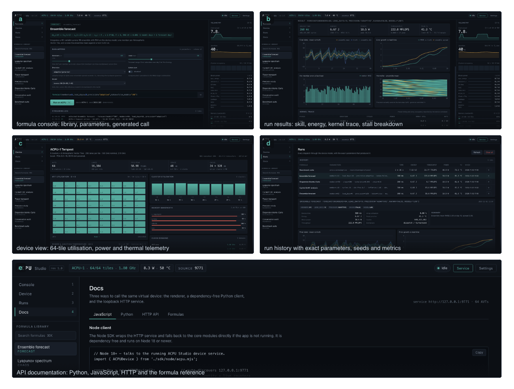
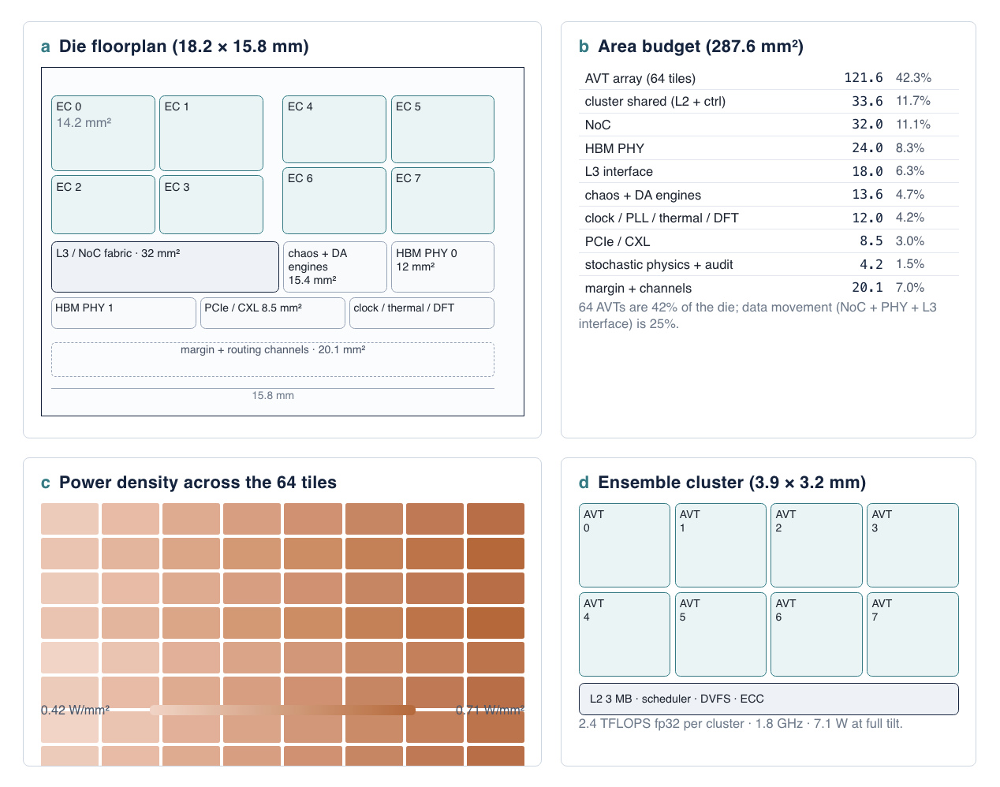
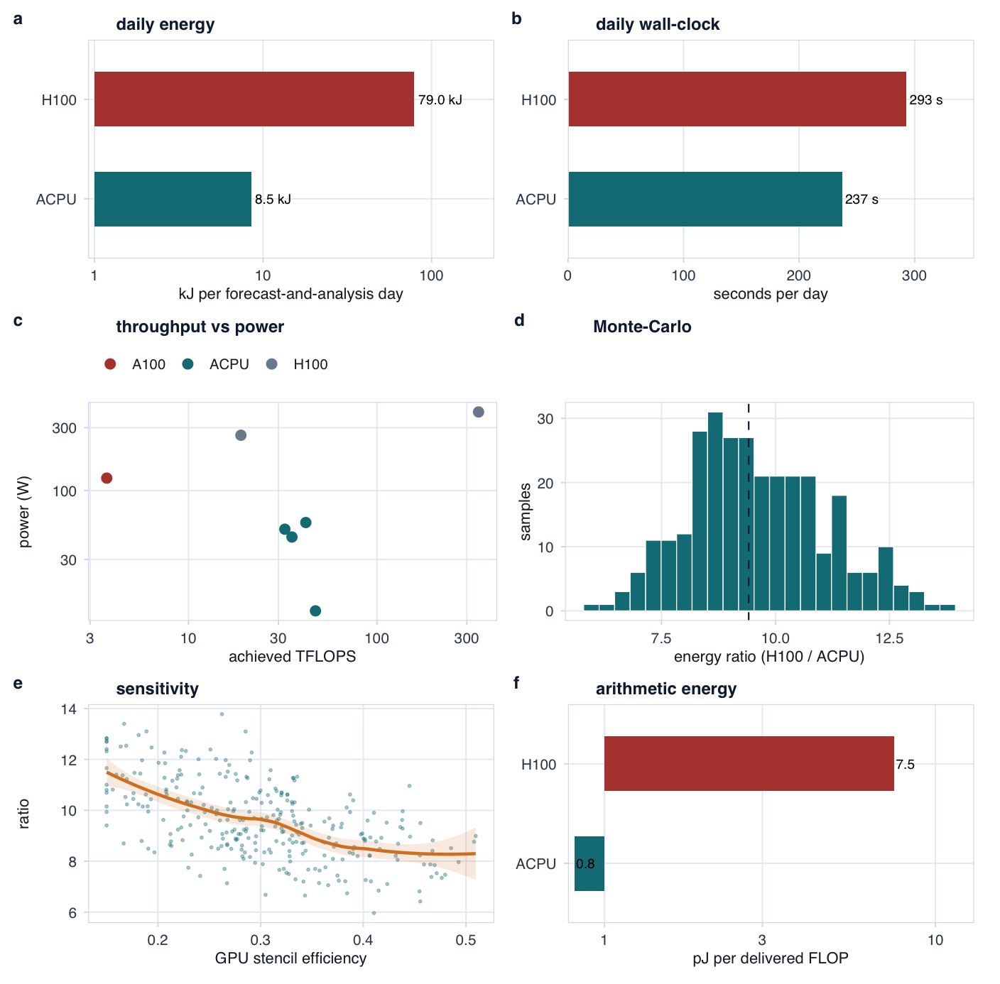
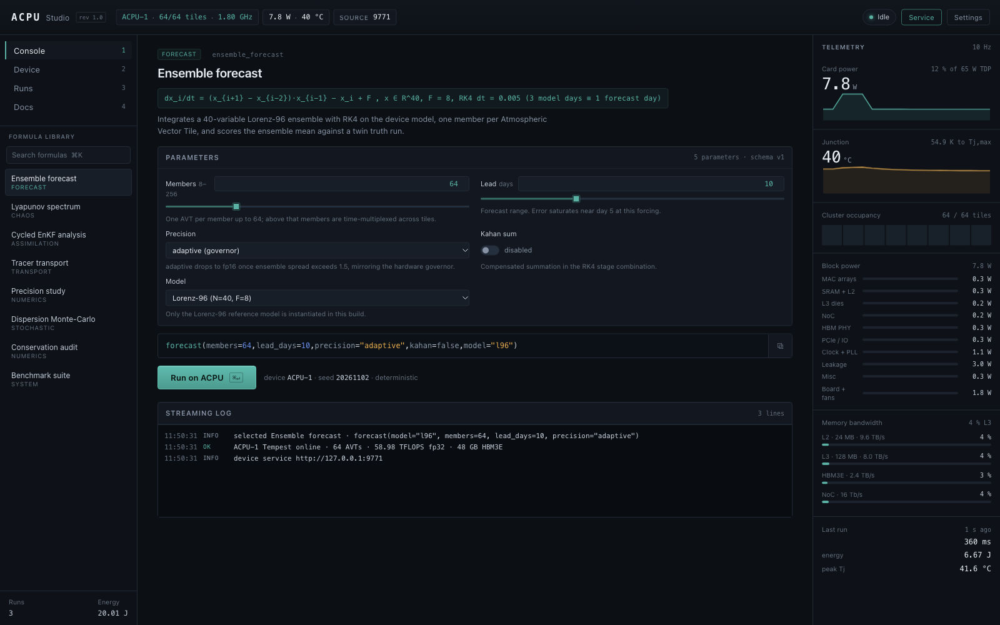
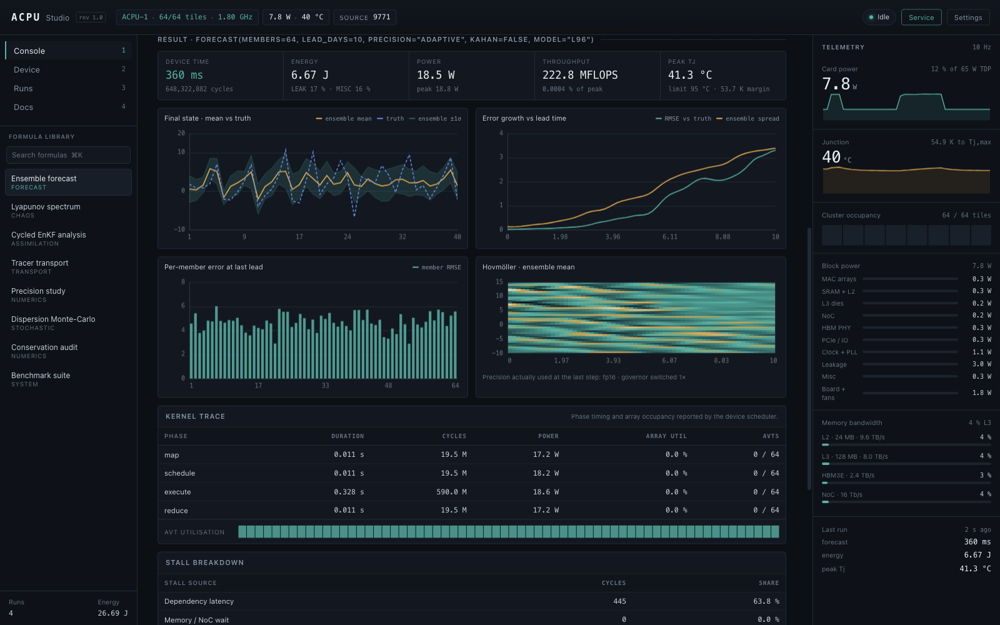
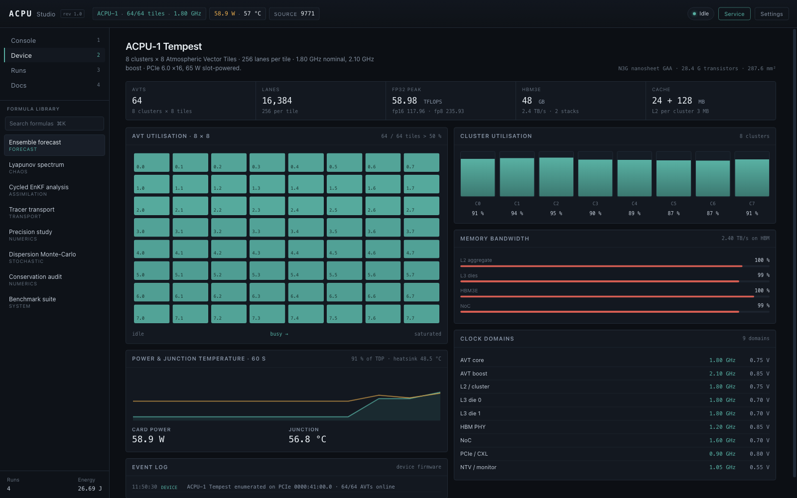
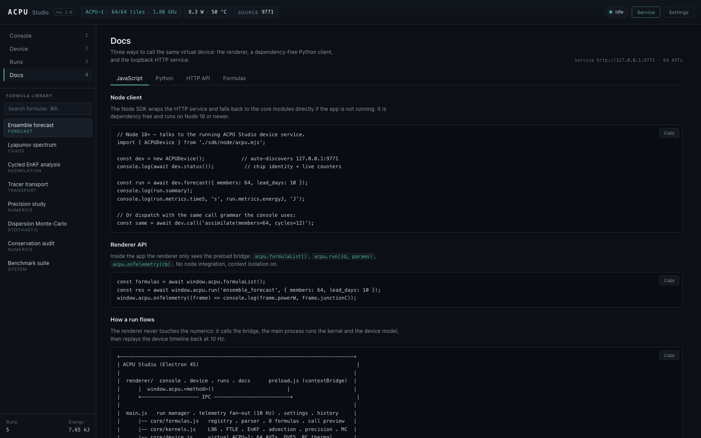

<div align="center">

# ACPU-1 "Tempest"

**An Atmospheric Calculation Processor Unit for ensemble chaotic computation**

Architecture · pre-silicon evaluation · 3 nm process · cross-platform software

[](LICENSE)
[](LICENSE-CC-BY-4.0)
[](ACPU-1_Technical_Report.pdf)
[](release/README.md)

</div>



## What this is

A complete design study of a domain-specific processor for **atmospheric chaotic
computation**: ensemble numerical weather prediction, data assimilation, dispersion and
chemical transport. It contains the architecture, a calibrated pre-silicon evaluation,
a 3 nm process and packaging plan, and a working cross-platform application that calls
the (virtual) device through one-line functions.

The design starts from three observations about the workload. Ensembles are the natural
parallel dimension, so **lanes carry ensemble members** rather than matrix rows. Stencils
are memory problems, so a **six-port halo fabric** exchanges boundaries in registers
instead of through a cache hierarchy. Forecast error in high-spread regions is chaotic
rather than arithmetic, so a **per-cell precision governor** runs physics in fp16 only
where an extra mantissa bit is worthless.

> **Honesty note.** There is no silicon. Every performance, energy, thermal, yield and
> cost figure for the chip is a projection from the calibrated model in `sim/`, with
> stated assumptions, a 300-sample Monte-Carlo interval, and an explicit
> "idealised GPU" bound. The distinction is maintained on the report's title page and in
> its limitations section.

## Headline results

| Metric | ACPU-1 | NVIDIA H100 | Result |
|---|---|---|---|
| 24 h, 64-member, 3 km ensemble (5.26 PFLOP) | **125.6 s · 7.17 kJ · 57.1 W** | 277.6 s · 73.0 kJ · 263 W | **10.2×** less energy, 2.2× faster |
| Forecast + 4 analyses (one operational day) | 237 s · 8.54 kJ | 293 s · 79.0 kJ | **9.3×** less energy (90% CI 7.3–12.3×) |
| Dense ensemble analysis | 27.9 s · 0.34 kJ | 3.8 s · 1.50 kJ | GPU 7.4× faster, still 4.4× more energy |
| Even with the GPU at 100% of fp32 peak | — | 33.5 kJ | still **3.9×** less energy |

The advantage is not arithmetic magic: 56% of the chip's energy is HBM traffic, 26% is
arithmetic and 15% is static. The report decomposes the 9.3× into measurable mechanisms
and shows which ones survive if the GPU assumptions are relaxed.

## The report

[**ACPU-1_Technical_Report.pdf**](ACPU-1_Technical_Report.pdf) — 45 pages, 26 figures
(5 of them with five or more panels), 16 tables, 24 references, English.

| | Chapter |
|---|---|
| 1–2 | Introduction · workload characterisation (equations, kernels, arithmetic intensity) |
| 3–4 | Architecture (clusters, tiles, memory, halo fabric) · microarchitecture and AVISA ISA |
| 5 | Precision, predictability and energy: why fp16 is safe, why fp8 is not |
| 6–7 | Performance and energy results including the CUDA comparison · numerical validation |
| 8–9 | 3 nm GAA + backside power, floorplan, package, thermal · test, yield, cost, reliability |
| 10–12 | Compiler, driver ABI, SDK and ACPU Studio · deployment and limitations · roadmap |

<table>
<tr>
<td width="50%"></td>
<td width="50%"></td>
</tr>
<tr>
<td align="center"><em>Fig. 3 — die floorplan, area and power density</em></td>
<td align="center"><em>Fig. 11 — energy comparison with the H100 baseline</em></td>
</tr>
</table>

## Repository layout

```
ACPU-1_Technical_Report.pdf   the deliverable (also built by scripts/build-report.sh)
report/                       LaTeX source of the report (XeTeX / Tectonic)
figs/
  src/                        R scripts (data figures) and HTML sources (schematics)
  out/                        vector PDFs used by the report
docs/images/                  curated previews used by this README
sim/                          pre-silicon model: numerics, cycle/power/thermal/cost
results/                      model outputs (JSON, CSV) and generated LaTeX macros
spec/acpu1.json               single source of truth for every design constant
app/                          ACPU Studio: Electron app, virtual device, SDKs
scripts/                      build-figures, build-report, package-app
release/                      artifact list and checksums (binaries live in Releases)
```

## Quick start

| Tool | Needed for | Version |
|---|---|---|
| Python + numpy | `sim/` | 3.10+ |
| R + ggplot2, patchwork, scales | data figures | 4.1+ |
| Node.js + npm | ACPU Studio, schematics | 20+ |
| Tectonic (XeTeX) | the report | 0.15+ |

```bash
# 1. the simulator: regenerates every number in the report (~40 s)
python sim/run_all.py

# 2. data figures (R) and schematic figures (Electron)
make figures-data
npm --prefix app install      # one-time, provides Electron for the schematics
make figures-html

# 3. the report
make report                   # -> ACPU-1_Technical_Report.pdf

# 4. the application
npm --prefix app run selftest # 246 assertions, headless
npm --prefix app start
```

`make all` runs the simulator, the figures and the report.

## ACPU Studio

A cross-platform desktop application that runs a **virtual ACPU-1** — the same 64-tile
device model, precision modes and telemetry as the report's simulator — and exposes it
through a formula console, a device view, run history and an API.

| | |
|---|---|
|  |  |
| Formula console: library, parameters, generated call | Results: skill, energy, kernel trace, stalls |
|  |  |
| Device view: 64-tile utilisation, power, temperature | Documentation: Python, JavaScript, HTTP |

Eight formulas, each a one-line call that maps onto the hardware primitives:

```python
import acpu                      # app/sdk/python
dev = acpu.ACPUDevice()          # the app's local device service, 127.0.0.1:9771

run = dev.forecast(model="l96", members=64, lead_days=10, precision="adaptive")
print(run["summary"], run["metrics"]["energyJ"])

spectrum = dev.lyapunov(model="l96", n_exp=12)
plume    = dev.transport(source=(22.75, 113.57), hours=6, resolution_km=3)
```

```js
import { ACPUDevice } from './app/sdk/node/acpu.mjs';
const dev = new ACPUDevice();
const run = await dev.forecast({ members: 64, lead_days: 10 });
```

The same surface is reachable over HTTP (`GET /v1/device`, `GET /v1/formulas`,
`POST /v1/run`, `GET /v1/runs/:id`). The service binds to loopback only and has no
authentication; treat it like a local developer tool.

## Installers

Prebuilt, unsigned installers for macOS (universal), Windows (x64, arm64, portable) and
Linux (AppImage, tarball) are distributed as GitHub **Release** assets — they are too
large for the git tree. Sizes and SHA-256 checksums are listed in
[`release/`](release/README.md); build them yourself with `scripts/package-app.sh`.

## Status and limitations

- No silicon, no RTL, no place-and-route database. Chip numbers are model projections.
- The GPU baseline is a model (0.30 stencil efficiency, a power-state model); both are
  varied in the sensitivity study, and the conclusion survives at 100% GPU utilisation.
- W1/W2 in the app are analytic cost-model workloads; W3–W5 execute real kernels.
- All Lorenz-96 runs are dispatch-bound on a 64-tile device, so their throughput reads
  low — that is the problem size, not a bug.
- Builds are unsigned; the loopback HTTP service is unauthenticated.

## Citation

If you use this work, cite it via [`CITATION.cff`](CITATION.cff):

> Zhang, Y. (2026). *ACPU-1 "Tempest": an atmospheric calculation processor unit for
> ensemble chaotic computation* (Technical Report ACPU-TR-001, Rev 1.0).

## License

Code (app, simulator, scripts, tools) is **MIT** — see [LICENSE](LICENSE).
The report, its LaTeX source and the figures are **CC BY 4.0** — see
[LICENSE-CC-BY-4.0](LICENSE-CC-BY-4.0).
