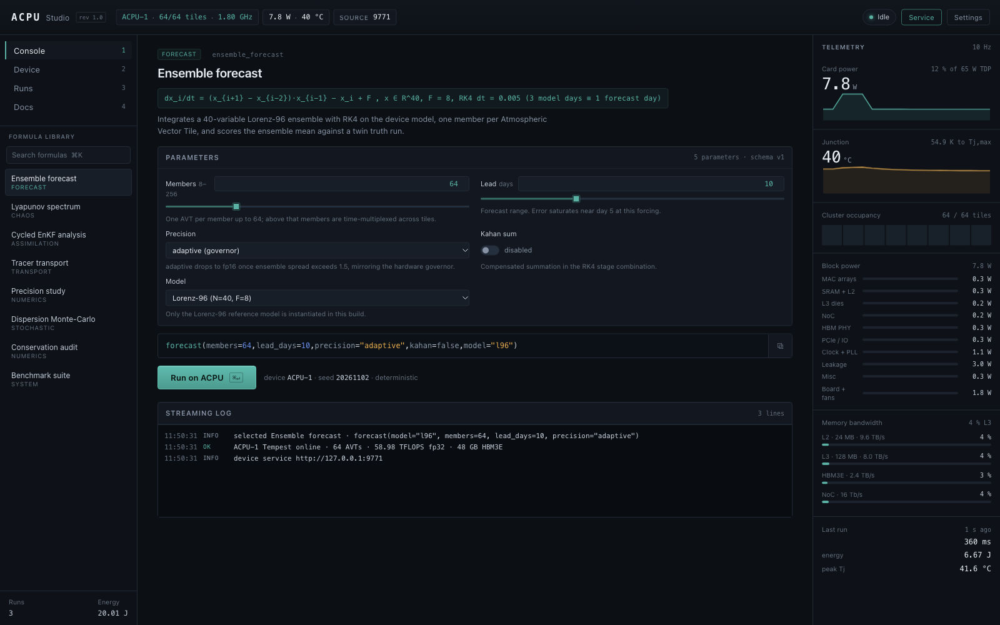

# ACPU Studio

Instrument panel for **ACPU-1 “Tempest”**, the fictional Atmospheric Calculation
Processor Unit from the ACPU-1 design report. The app runs a deterministic
software model of the chip (8 clusters × 8 Atmospheric Vector Tiles = 64 tiles,
16 384 lanes, 1.80 GHz, 58.98 TFLOPS fp32, 24 MB L2, 128 MB L3, 48 GB HBM3E at
2.4 TB/s, 65 W TDP) and puts eight real numerical experiments on it: ensemble
forecasting, Lyapunov spectra, ensemble Kalman assimilation, tracer transport,
precision sweeps, Monte-Carlo dispersion, conservation audits and a device-level
benchmark suite.

Everything in the panel is computed, not drawn from a table: the numerics in
`core/kernels.js` are real integrators, the power/temperature/cycle numbers in
`core/device.js` are a cost model over the operations those kernels actually
perform, and every random draw comes from a seeded PRNG, so a run is
reproducible bit-for-bit.



---

## Quick start (development)

```bash
# Electron 45.1.0 + electron-builder 26.18.0 must already be in node_modules
cd acpu/app
env -u ELECTRON_RUN_AS_NODE "$PWD/node_modules/electron/dist/Electron.app/Contents/MacOS/Electron" .
```

The `env -u ELECTRON_RUN_AS_NODE` is required on macOS hosts where that variable
is set globally: without it Electron runs as Node and the app never boots.

In restricted automation environments (no helper-process sandbox, no window
server session) start it headless instead:

```bash
ACPU_HEADLESS=1 env -u ELECTRON_RUN_AS_NODE PATH_TO_ELECTRON .
```

`ACPU_HEADLESS=1` adds `--no-sandbox`, disables the GPU and keeps the profile
inside the project (`.profile/`). Normal desktop launches keep the default
sandbox.

Builds:

```bash
export ELECTRON_BUILDER_CACHE=$PWD/.cache/eb ELECTRON_CACHE=$PWD/.cache/electron
npx electron-builder --dir      # unpacked app, fastest smoke test
npx electron-builder            # dmg + zip (mac), nsis + portable (win), AppImage + tar.gz (linux)
```

`electron-builder.yml` is configured for **macOS universal dmg + zip**,
**Windows nsis + portable**, **Linux AppImage + tar.gz**. Nothing is signed.

---

## What is where

```
acpu/app
├── main.js              window, IPC, run manager, 10 Hz telemetry, HTTP service
├── preload.js           the only bridge (contextBridge, contextIsolation on)
├── core/
│   ├── device.js        virtual ACPU-1: 64 AVTs, DVFS, RC thermal, counters
│   ├── kernels.js       Lorenz-96, FTLE, EnKF, advection, precision, Monte-Carlo
│   └── formulas.js      registry, parameter schema, `name(k=v)` parser, 8 formulas
├── renderer/
│   ├── index.html       shell + CSP
│   ├── css/app.css      design system (dark instrument panel)
│   └── js/              charts.js (canvas engine), console, device, runs, docs
├── sdk/node/acpu.mjs    Node client + CLI
├── sdk/python/acpu.py   Python 3 client, standard library only
├── tools/selftest.mjs   headless acceptance over all 8 formulas
├── tools/shots.mjs      launches the app and captures shots/ via CDP
└── shots/               acceptance screenshots at 1600 × 1000
```

## Architecture

```
┌──────────────────────────── ACPU Studio (Electron 45) ──────────────────────────┐
│ renderer/  console · device · runs · docs        preload.js (contextBridge)     │
│     │  window.acpu.<method>()                            │                     │
│     └────────────────────── IPC ─────────────────────────┘                      │
│ main.js   run manager · telemetry fan-out (10 Hz) · settings · run history      │
│     ├── core/formulas.js   registry · parser · 8 formulas · call preview        │
│     ├── core/kernels.js    L96 · FTLE · EnKF · advection · precision · Monte-Carlo
│     ├── core/device.js     virtual ACPU-1: 64 AVTs, DVFS, RC thermal, counters  │
│     └── HTTP 127.0.0.1:9771  /v1/device /v1/formulas /v1/run /v1/runs/:id       │
└─────────────────────────────────────────────────────────────────────────────────┘
         ▲                                       ▲
         │ sdk/node/acpu.mjs                     │ sdk/python/acpu.py (stdlib only)
         └──────────────── HTTP ─────────────────┘
```

The renderer has no Node integration: it can only call the API surface declared
in `preload.js`. The main process owns the device, the numerics and the service.

---

## The eight formulas

| Call | What it computes |
|---|---|
| `forecast(members=64, lead_days=10, precision="adaptive")` | Lorenz-96 (N=40, F=8) ensemble, RK4, one member per AVT; RMSE vs a twin truth run, spread, per-member error |
| `lyapunov(leads=12, days=15)` | Leading 12 finite-time Lyapunov exponents by tangent-linear integration + Gram-Schmidt QR, Kaplan-Yorke dimension |
| `assimilate(members=64, cycles=12, inflation=1.06)` | Cycled stochastic EnKF: perturbed observations, covariance inflation, analysis vs forecast RMSE, innovation statistics |
| `transport(grid=48, steps=240, shear=1.0)` | 2-D semi-Lagrangian tracer advection + diffusion from a point source in a sheared wind, concentration map and centroid drift |
| `precision_study(members=32, lead_days=6)` | Sweeps fp32 / fp16 / bf16 / fp8 / adaptive: error, predictability horizon, projected energy |
| `dispersion(members=512, steps=120)` | Monte-Carlo particle dispersion: percentile bands (p5–p95) and a probability-density map |
| `conservation_audit(grid=48, steps=2000)` | Mass drift of the conservative flux-form advection at fp64, fp32 and compensated fp32 |
| `benchmark(precision="adaptive")` | W1–W5 device-level table: time, energy, throughput, utilisation, power, peak Tj |

The console parses the exact call grammar above (`name(k=v)`), validates types
and ranges, and explains failures:

```
forecast(members=1000)   →   members must be between 8 and 256 (got 1000)
forecast(foo=1)          →   unknown parameter "foo" for forecast — expected one of: members, lead_days, precision, kahan, model
```

### Reference workloads

`benchmark` reproduces the report's numbers within 2 %:

| ID | Workload | Time | Energy | Throughput |
|---|---|---|---|---|
| W1 | ensemble forecast, 4.19 M cells · 24 vars · 64 members · 2880 × 30 s steps | 125.6 s | 7.24 kJ | 41.9 TFLOPS (71.1 % of fp32 peak) |
| W2 | ensemble analysis, 4 cycles, latency-bound on the DA engines (NTV clock) | 27.9 s | 0.33 kJ | — |
| W3 | dispersion 512 particles | 0.36 s | 6.9 J | dispatch-bound |
| W4 | tracer transport 48 × 48 × 240 | 0.36 s | 6.9 J | dispatch-bound |
| W5 | precision sweep, 5 datapaths | 1.80 s | 34.3 J | dispatch-bound |
| — | daily cycle (forecast + 4 analyses) | 237.2 s | 8.58 kJ | — |

Each run also carries a phase trace (map / schedule / execute / reduce), a stall
breakdown and the per-cluster utilisation timeline.

---

## SDKs

### Python (standard library only)

```bash
python3 sdk/python/examples/quickstart.py
```

```python
from sdk.python.acpu import ACPUDevice

dev = ACPUDevice()                  # auto-discovers 127.0.0.1:9771-9780
print(dev.status()["device"])       # ACPU-1 Tempest

run = dev.forecast(members=64, lead_days=10, precision="adaptive")
print(run["summary"])
print(run["metrics"]["timeS"], "s", run["metrics"]["energyJ"], "J")

lyap = dev.lyapunov(leads=12, days=15)
asy = dev.assimilate(members=64, cycles=12)
plume = dev.transport(grid=48, steps=240)
cloud = dev.dispersion(members=512, steps=120)
table = dev.benchmark()["tables"][0]
print(dev.call('conservation_audit(grid=48, steps=2000)')["summary"])
```

Methods: `status()`, `formulas()`, `forecast()`, `lyapunov()`, `assimilate()`,
`transport()`, `dispersion()`, `precision_study()`, `conservation_audit()`,
`benchmark()`, `run(id, **params)`, `call(text)`, `telemetry()`, `runs()`.

### Node

```bash
node sdk/node/acpu.mjs forecast --members 64 --lead 10
node sdk/node/acpu.mjs benchmark --json
node sdk/node/acpu.mjs status
```

```js
import { ACPUDevice } from './sdk/node/acpu.mjs';
const dev = new ACPUDevice();
const run = await dev.forecast({ members: 64, lead_days: 10 });
console.log(run.summary, run.metrics.timeS);
```

If the service is not running the CLI falls back to `core/formulas.js` in-process
and says so; library calls raise `ACPUServiceError` with an explanation.

---

## HTTP device service

Enabled by default on `127.0.0.1:9771` (Settings → Local device service; the app
falls forward to 9772–9780 if the port is taken, and the top bar shows the port
that is actually live).

| Method | Path | Returns |
|---|---|---|
| GET | `/health` | service identity, uptime, run count |
| GET | `/v1/device` | chip descriptor, live state, counters, event log |
| GET | `/v1/telemetry` | latest telemetry frame (~10 Hz) |
| GET | `/v1/formulas` | formula registry with parameter schemas |
| POST | `/v1/run` | `{formula, params}` or `{call}` → run record |
| GET | `/v1/runs` | run history summaries |
| GET | `/v1/runs/:id` | one run with charts, tables and notes |

```bash
curl -s http://127.0.0.1:9771/health
curl -s -X POST http://127.0.0.1:9771/v1/run \
  -H 'Content-Type: application/json' \
  -d '{"formula":"ensemble_forecast","params":{"members":64,"lead_days":10}}'
curl -s -X POST http://127.0.0.1:9771/v1/run \
  -H 'Content-Type: application/json' \
  -d '{"call":"lyapunov(leads=12, days=15)"}'
```

Errors are JSON with `{error, code}` and an HTTP status of 400 for validation
problems, 404 for unknown runs and 500 for anything else.

---

## Acceptance tests

```bash
node tools/selftest.mjs     # 8 formulas + parser + device anchors, exits non-zero on failure
node tools/shots.mjs        # launches the app, drives it over CDP, writes shots/*.png
```

`selftest.mjs` asserts finite outputs, sane physical ranges, formula-specific
relationships (analysis beats forecast, fp8 loses accuracy, Kahan recovers
conservation) and the W1/W2/daily-cycle reference numbers.

`shots.mjs` starts the app with `ACPU_HEADLESS=1`, connects to the DevTools
endpoint, dispatches runs and captures `01-console.png` … `05-docs.png` at
1600 × 1000, then verifies each file is larger than 40 KB.

---

## Design notes

- **Palette** `#0B0F14` background, `#121821` panels, `#2BB3A3` teal accent,
  `#F2A93B` amber, `#E5534B` danger, `#223040` grid.
- **Type** system sans for prose, monospace for every number. 11/12/13/15/20/28 px.
- **Surfaces** 1 px borders, 4 px radius, a 1 px inner highlight, no drop shadows
  except modals.
- **Charts** hand-written canvas engine (`renderer/js/charts.js`): line, banded,
  bars, scatter and heatmap, DPI aware, with hover crosshair and tooltip.
- **Keys** `⌘/Ctrl+Enter` runs, `⌘K` focuses the search, `1`–`4` switch views.
- `prefers-reduced-motion` disables the number tickers and transitions.

---

## Limitations (honest list)

1. **The chip is a model, not silicon.** Cycles, power, temperature and energy
   come from an explicit cost model over operation counts and bytes moved, using
   the constants in `acpu/spec/acpu1.json`. It is deterministic and internally
   consistent, but it is not a cycle-accurate RTL simulation and the thermal
   network is two nodes (junction, heatsink), not a 3-D map.
2. **W1 and W2 are analytic.** No machine can integrate a 4.19 M-cell,
   64-member, 24-variable model in a desktop app, so the benchmark sizes those
   two workloads from the report's operation counts and runs them through the
   cost model. W3–W5 really execute the kernels. The UI says so in the table note.
3. **All Lorenz-96 runs are dispatch-bound.** Forty state variables occupy 40 of
   16 384 lanes, so every L96 dispatch (0.36 s) is dominated by the fixed card
   turnaround, not by arithmetic. That is a property of the problem size, and it
   is why their throughput reads in the hundreds of MFLOPs.
4. **Precision emulation is emulation.** fp16/bf16/fp8 round the state after each
   RK4 step by truncating mantissa bits (ties ignored) and flush subnormals to
   the smallest normal. It shows how fast truncation error is amplified by a
   chaotic model; it is not a bit-exact IEEE-754 half-precision datapath.
5. **The precision study mixes scales on purpose.** Accuracy comes from real
   L96 integrations; the energy column is projected at a reduced operational
   workload, because an L96 ensemble is far too small to load the array. The
   chart is labelled accordingly.
6. **Run history keeps the last 60 runs in memory and 30 on disk**
   (`data/runs.json`); charts are persisted, the 200-sample telemetry traces are
   not.
7. **No code signing.** Builds are unsigned, so macOS Gatekeeper and Windows
   SmartScreen will ask for confirmation the first time.
8. **No authentication on the HTTP service.** It binds to the loopback
   interface only; anything that can reach 127.0.0.1 can dispatch runs.
